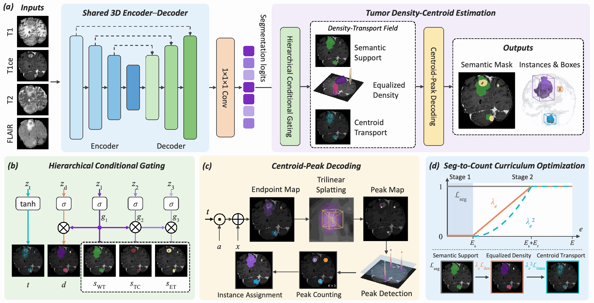

# MicroBT++

**Density-Centroid Coupled Learning for Micro Brain Tumor Segmentation and Counting**

Qing Xu, Zhenye Lou, Yixuan Zhang, Xiangjian He, Stefanie Thust, Dorothee P. Auer, Wenting Duan, and Zhen Chen

MicroBT++ extends the research direction of [MicroBT](https://github.com/leonlou921/MicroBT) with **Count-Coupled Segmentation (CCS)**, **Tumor Density-Centroid Estimation (TDCE)**, and **Seg-to-Count Curriculum Optimization (SCCO)**. A shared density-transport field couples semantic segmentation with lesion instances and counting, with particular attention to micro tumors.

[Method](docs/METHOD.md) · [Manuscript results](docs/RESULTS.md) · [Quick start](#quick-start) · [Paper/code alignment](METHOD_CODE_ALIGNMENT.md) · [Citation](CITATION.cff)

## Overview

[](docs/assets/microbtpp_framework.png)

*Framework overview from the supplied manuscript, Figure 2. Click to view the full-resolution figure.*

- **CCS:** connects voxel-level segmentation and instance-level counting through one structured field.
- **TDCE:** predicts hierarchical semantic support, equalized lesion density, and centroid-directed transport; deterministic decoding yields instances, boxes, centroids, and a count.
- **SCCO:** learns semantic support first, then progressively introduces density and transport objectives along their dependency chain.

The manuscript reports an average reduction in micro-tumor counting MAPE of **38.2% for tumors ≤3 mm** and **31.3% for tumors ≤5 mm**, relative to the best non-MicroBT++ baseline in each dataset/size setting across six datasets. These are manuscript-reported results, not measurements from this repository's automated tests.

## From MicroBT to MicroBT++

| Aspect | [MicroBT](https://github.com/leonlou921/MicroBT) | MicroBT++ |
| --- | --- | --- |
| Main representation | Centroid-guided synergistic segmentation and localization | Coupled semantic support, density, and transport field |
| Method components | CAS and VC-Loss | CCS and TDCE |
| Curriculum | SACO: two-stage size-aware optimization | SCCO: progressive activation of segmentation, density, and transport objectives |
| Instance/count recovery | Final-mask connected components under the MicroBT evaluation contract | Centroid-peak decoding and endpoint-space instance assignment |

This repository follows MicroBT's presentation and documentation structure. Its current execution entry points are the scripts below; it does not expose the `microbt.cli` pipeline from the earlier repository.

## Pipeline

```text
aligned multi-modal MRI -> nnU-Net preprocessing -> shared 3D encoder-decoder
                      -> hierarchical semantic / density / transport field
                      -> semantic-first, density-then-transport curriculum
                      -> centroid-peak decoding -> segmentation / instances / count
```

The supplied final trainer uses one 300-epoch trajectory with progressive objective activation. The curriculum's two stages are phases within that trajectory.

## Quick start

The training target is a compatible Linux/CUDA environment with Python 3.10 or later. Install the appropriate PyTorch build for your device first. The supplied dependency list is unpinned; full runtime compatibility must be validated on the target host.

```bash
git clone https://github.com/leonlou921/MicroBT-PlusPlus.git
cd MicroBT-PlusPlus
python -m pip install -r requirements.txt
export PYTHONPATH="$PWD${PYTHONPATH:+:$PYTHONPATH}"
cp .env.example .env
```

Edit `.env` with your own resource paths and generic dataset specification, then load it:

```bash
set -a
. ./.env
set +a
```

Inspect the final training contract without loading data or starting training:

```bash
bash scripts/run_microbt_umctf_sacl_c2_foldall_scratch300.sh --print-contract
```

After preparing the required data, plans and metadata, establish a local source baseline and run the training template:

```bash
python scripts/build_umctf_sacl_c2_source_manifest.py write
python scripts/build_umctf_sacl_c2_source_manifest.py verify
bash scripts/run_microbt_umctf_sacl_c2_foldall_scratch300.sh
```

The current launcher retains a fixed cohort-size contract and `fold=all`. Review [Training](docs/TRAINING.md) and [Reproducibility](docs/REPRODUCIBILITY.md) before adapting it to another dataset or using it to interpret manuscript results.

## Manuscript results

Reported MicroBT++ results from manuscript Tables 1 and 2. Dice and HD95 refer to whole-tumor segmentation; AP_vox uses the manuscript's one-voxel-overlap detection criterion. Higher Dice/AP and lower HD95/MAPE are better.

| Dataset | Dice ↑ | HD95 (mm) ↓ | AP_vox ↑ | MAPE ↓ |
| --- | ---: | ---: | ---: | ---: |
| BraTS-GLI | 0.941 | 3.55 | 0.621 | 0.395 |
| BraTS-MEN | 0.914 | 6.51 | 0.762 | 0.164 |
| BraTS-PED | 0.819 | 6.23 | 0.590 | 0.450 |
| BraTS-MET | 0.760 | 13.35 | 0.683 | 0.568 |
| MoLab-BM | 0.730 | 40.72 | 0.543 | 1.127 |
| Pretreat-Mets | 0.841 | 4.16 | 0.776 | 0.463 |

The full comparison tables, micro-tumor size strata, and source notes are in [Results](docs/RESULTS.md). The public snapshot and the supplied manuscript have documented implementation/protocol differences; no exact paper-score reproduction is claimed.

## Outputs

- **Field:** nested region probabilities, nonnegative lesion density, and bounded centroid transport.
- **Decoder:** centroid coordinates and scores, instance labels, atom map, and a count equal to the number of retained peaks.
- **Evaluation:** local prediction arrays, case records, progress and summary files.
- **Native export:** semantic and instance NIfTI files when the evaluator/exporter's prerequisites are satisfied.

See [Inference](docs/INFERENCE.md) and [Evaluation](docs/EVALUATION.md) for formats and definitions.

## Documentation

- [Method and manuscript terminology](docs/METHOD.md)
- [Manuscript results and comparisons](docs/RESULTS.md)
- [Data format and configuration](docs/DATA.md)
- [Training and recovery](docs/TRAINING.md)
- [Inference and output contract](docs/INFERENCE.md)
- [Evaluation definitions](docs/EVALUATION.md)
- [Reproducibility and implementation differences](docs/REPRODUCIBILITY.md)
- [GPU smoke test](docs/GPU_SMOKE.md)
- [Troubleshooting](docs/TROUBLESHOOTING.md)
- [Model card](docs/MODEL_CARD.md)
- [Paper-to-code mapping](METHOD_CODE_ALIGNMENT.md)
- [Public release scope](docs/PUBLIC_RELEASE.md)

## Tests

```bash
python -m unittest discover -s tests -v
```

The dependency-free checks exercise public configuration, printed contracts, and local source-drift detection. GitHub Actions also checks Python/Bash syntax and a small original protocol-test subset. The full historical unit suite requires training dependencies and, for some tests, external data or CUDA extensions. These checks do not reproduce paper scores.

## Manuscript and citation

The figures and reported tables are drawn from the author-supplied manuscript named above. No public paper URL, DOI, or acceptance status is asserted. Bibliographic metadata are in [CITATION.cff](CITATION.cff), and a BibTeX entry is in [docs/CITATION.md](docs/CITATION.md).

## Attribution and release scope

MicroBT++ builds on [nnU-Net v2](https://github.com/MIC-DKFZ/nnUNet) and follows the research lineage of [MicroBT](https://github.com/leonlou921/MicroBT). The input source bundle did not include complete license/version provenance; this update adds no new licensing grant.

The public release uses generic paths and synthetic private-case examples. Data, weights, original environment information, concrete source/data/checkpoint hash records, and machine-specific extension binaries remain unpublished. Manuscript illustrations are research figures, not downloadable patient datasets. Internal implementation names `UMCTF`, `CTF`, and `SACL` are retained; see the alignment notes for exact behavior.
