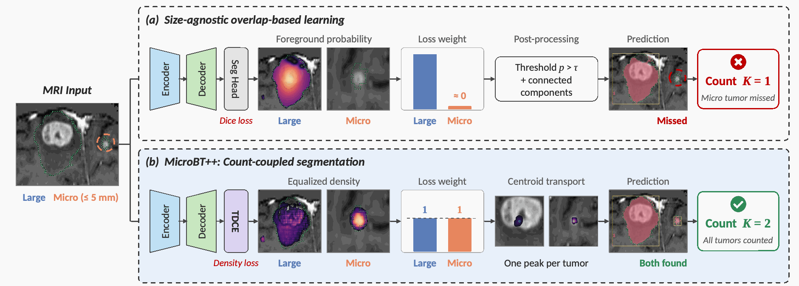

# Method

MicroBT++ is described in the manuscript **Density-Centroid Coupled Learning for Micro Brain Tumor Segmentation and Counting**. It extends the research line of [MicroBT](https://github.com/leonlou921/MicroBT).

## Count-Coupled Segmentation (CCS)

The manuscript motivates a scale mismatch: segmentation optimizes voxel overlap, whereas counting treats every lesion as one instance. CCS couples the tasks through semantic support `s`, lesion density `d`, and centroid transport `t`. The intended per-lesion density integrates to one, so small and large lesions can both carry one unit of count mass.

## Tumor Density-Centroid Estimation (TDCE)

A shared 3D encoder-decoder produces seven channels for three nested regions, three transport components and one density component. Conditional sigmoid gating enforces ET ⊆ TC ⊆ WT; the WT gate also restricts nonnegative density. A tanh bounds transport components.

The decoder maps voxel locations toward predicted centroids, accumulates density by trilinear splatting, finds and filters local peaks, and assigns supported voxels to peaks in endpoint space. Count is the number of retained peaks, while instance labels determine bounding boxes.

Implementation entry points:

- [Field parameterization](../nnunetv2/nets/microbt_umctf/model.py)
- [Mass-conservation objective](../nnunetv2/training/loss/microbt_umctf_losses.py)
- [Transport/assignment objective](../nnunetv2/training/loss/microbt_ctf_losses.py)
- [Centroid-peak decoder](../nnunetv2/inference/microbt_umctf_decode.py)

## Seg-to-Count Curriculum Optimization (SCCO)

The manuscript's objective is `L_seg + alpha_d * lambda_e * L_den + alpha_t * lambda_e^2 * L_trans`. The current continuation helper uses semantic-only epochs 0–4, a 25-epoch ramp, and an endpoint at epoch 29. Measure and transport weights are respectively `0.25 * lambda_e` and `0.25 * lambda_e^2`.

The code's older term `SACL` corresponds to this objective-continuation mechanism. It is distinct from the earlier MicroBT repository's SACO training pipeline. The final trainer follows one 300-epoch schedule.

## Implementation boundary

The structural ideas and continuation schedule map to the released code, but the exact loss formulas differ from the manuscript's compact equations. In particular, the source implements integrated-mass Smooth-L1 and physical endpoint/assignment consistency terms. See [Paper-to-code alignment](../METHOD_CODE_ALIGNMENT.md) before treating the snapshot as an equation-exact reproduction.
