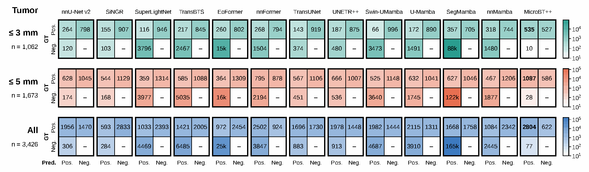

# Manuscript-reported results

The following tables are transcribed from the author-supplied manuscript **Density-Centroid Coupled Learning for Micro Brain Tumor Segmentation and Counting**. They are reported experimental results, not measurements rerun in this publication task. Public benchmark names below are manuscript dataset labels; they are not private local dataset-folder identifiers.

## Whole-tumor segmentation

Each cell is Dice ↑ / HD95 (mm) ↓. Source: Table 1, manuscript page 6.

| Method | BraTS-GLI | BraTS-MEN | BraTS-PED | BraTS-MET | MoLab-BM | Pretreat-Mets |
| --- | ---: | ---: | ---: | ---: | ---: | ---: |
| nnU-Net v2 | 0.936 / 4.35 | 0.902 / 9.24 | 0.808 / 6.43 | 0.727 / 15.23 | 0.732 / 36.17 | 0.819 / 4.93 |
| SiNGR | 0.915 / 7.58 | 0.831 / 11.49 | 0.780 / 10.10 | 0.566 / 29.65 | 0.527 / 54.64 | 0.747 / 12.34 |
| SuperLightNet | 0.903 / 7.45 | 0.753 / 15.69 | 0.779 / 14.09 | 0.361 / 47.24 | 0.255 / 51.48 | 0.630 / 17.77 |
| TransBTS | 0.876 / 5.40 | 0.584 / 13.78 | 0.593 / 11.27 | 0.490 / 34.09 | 0.416 / 64.92 | 0.748 / 14.78 |
| EoFormer | 0.899 / 9.35 | 0.860 / 11.55 | 0.752 / 12.43 | 0.625 / 26.46 | 0.578 / 49.78 | 0.782 / 7.24 |
| nnFormer | 0.929 / 5.62 | 0.781 / 18.52 | 0.811 / 8.39 | 0.687 / 16.84 | 0.637 / 41.48 | 0.808 / 5.82 |
| TransUNet | 0.940 / 3.86 | 0.862 / 23.39 | 0.793 / 19.13 | 0.656 / 20.53 | 0.696 / 45.96 | 0.772 / 5.19 |
| UNETR++ | 0.935 / 3.63 | 0.789 / 13.76 | 0.796 / 6.78 | 0.640 / 23.36 | 0.616 / 29.87 | 0.794 / 5.29 |
| Swin-UMamba | 0.932 / 4.71 | 0.833 / 8.73 | 0.813 / 11.79 | 0.649 / 26.06 | 0.669 / 53.55 | 0.825 / 8.27 |
| U-Mamba | 0.939 / 3.56 | 0.888 / 10.58 | 0.816 / 9.13 | 0.659 / 19.94 | 0.663 / 44.05 | 0.731 / 7.12 |
| SegMamba | 0.918 / 6.99 | 0.858 / 11.85 | 0.814 / 8.59 | 0.642 / 22.80 | 0.621 / 44.99 | 0.790 / 6.74 |
| nnMamba | 0.893 / 8.26 | 0.821 / 22.38 | 0.801 / 8.88 | 0.668 / 19.07 | 0.687 / 30.30 | 0.783 / 4.84 |
| **MicroBT++** | 0.941 / 3.55 | 0.914 / 6.51 | 0.819 / 6.23 | 0.760 / 13.35 | 0.730 / 40.72 | 0.841 / 4.16 |

## Lesion detection and counting

Each cell is AP_vox ↑ / MAPE ↓. Source: Table 2, manuscript page 6.

| Method | BraTS-GLI | BraTS-MEN | BraTS-PED | BraTS-MET | MoLab-BM | Pretreat-Mets |
| --- | ---: | ---: | ---: | ---: | ---: | ---: |
| nnU-Net v2 | 0.608 / 0.442 | 0.751 / 0.397 | 0.596 / 0.518 | 0.613 / 0.682 | 0.538 / 1.262 | 0.509 / 0.499 |
| SiNGR | 0.583 / 0.627 | 0.548 / 0.862 | 0.483 / 0.829 | 0.218 / 0.946 | 0.160 / 1.495 | 0.258 / 1.064 |
| SuperLightNet | 0.613 / 1.028 | 0.673 / 2.034 | 0.575 / 0.523 | 0.225 / 2.674 | 0.289 / 9.162 | 0.382 / 0.722 |
| TransBTS | 0.444 / 0.937 | 0.154 / 2.174 | 0.441 / 0.630 | 0.198 / 4.491 | 0.130 / 3.705 | 0.234 / 1.690 |
| EoFormer | 0.594 / 3.713 | 0.648 / 0.847 | 0.593 / 0.990 | 0.476 / 1.086 | 0.264 / 1.826 | 0.448 / 1.046 |
| nnFormer | 0.607 / 0.738 | 0.666 / 2.246 | 0.585 / 0.948 | 0.537 / 0.985 | 0.531 / 5.461 | 0.498 / 1.012 |
| TransUNet | 0.620 / 0.617 | 0.414 / 1.851 | 0.525 / 4.243 | 0.390 / 0.895 | 0.535 / 1.653 | 0.379 / 2.147 |
| UNETR++ | 0.611 / 1.004 | 0.706 / 1.363 | 0.595 / 0.967 | 0.424 / 0.741 | 0.444 / 1.728 | 0.410 / 0.742 |
| Swin-UMamba | 0.616 / 2.079 | 0.739 / 0.985 | 0.590 / 1.063 | 0.499 / 1.879 | 0.103 / 9.588 | 0.495 / 2.190 |
| U-Mamba | 0.601 / 0.641 | 0.709 / 0.651 | 0.503 / 3.662 | 0.491 / 1.023 | 0.456 / 1.243 | 0.468 / 2.505 |
| SegMamba | 0.605 / 1.027 | 0.724 / 0.847 | 0.563 / 2.074 | 0.185 / 8.928 | 0.222 / 1.979 | 0.330 / 8.537 |
| nnMamba | 0.559 / 4.435 | 0.744 / 1.919 | 0.590 / 0.477 | 0.450 / 0.967 | 0.528 / 1.591 | 0.418 / 0.770 |
| **MicroBT++** | 0.621 / 0.395 | 0.762 / 0.164 | 0.590 / 0.450 | 0.683 / 0.568 | 0.543 / 1.127 | 0.776 / 0.463 |

## Micro-tumor counting by size

Each cell is MAPE at ≤3 mm / MAPE at ≤5 mm; lower is better. Source: Table 5, manuscript page 8.

| Method | BraTS-GLI | BraTS-MEN | BraTS-PED | BraTS-MET | MoLab-BM | Pretreat-Mets |
| --- | ---: | ---: | ---: | ---: | ---: | ---: |
| nnU-Net v2 | 0.471 / 0.465 | 0.385 / 0.362 | 0.509 / 0.600 | 1.152 / 0.992 | 2.069 / 1.132 | 0.963 / 0.552 |
| SiNGR | 0.757 / 0.694 | 1.033 / 0.900 | 0.887 / 0.721 | 1.153 / 0.865 | 1.666 / 1.006 | 0.797 / 0.652 |
| SuperLightNet | 1.535 / 1.268 | 2.260 / 1.148 | 0.641 / 0.608 | 2.935 / 1.829 | 10.291 / 6.449 | 1.141 / 0.784 |
| TransBTS | 1.220 / 0.804 | 1.839 / 1.430 | 0.606 / 0.521 | 5.599 / 3.080 | 7.252 / 2.499 | 2.054 / 1.189 |
| EoFormer | 3.505 / 2.705 | 1.030 / 0.902 | 1.080 / 1.040 | 1.167 / 1.071 | 2.589 / 1.490 | 1.172 / 0.850 |
| nnFormer | 0.898 / 0.771 | 2.345 / 2.081 | 1.442 / 0.866 | 1.172 / 0.730 | 6.892 / 3.329 | 1.218 / 0.852 |
| TransUNet | 0.955 / 0.558 | 1.975 / 1.688 | 3.547 / 3.151 | 0.920 / 0.903 | 2.244 / 1.380 | 2.303 / 1.999 |
| UNETR++ | 1.022 / 0.744 | 1.553 / 1.242 | 1.056 / 0.790 | 0.881 / 0.852 | 2.098 / 1.526 | 0.684 / 0.648 |
| Swin-UMamba | 2.349 / 1.552 | 1.073 / 0.916 | 1.598 / 1.208 | 2.737 / 1.525 | 11.778 / 4.300 | 1.952 / 1.648 |
| U-Mamba | 0.830 / 0.664 | 0.785 / 0.673 | 5.569 / 1.917 | 1.068 / 0.726 | 1.529 / 0.851 | 2.872 / 2.175 |
| SegMamba | 1.149 / 0.611 | 0.776 / 0.635 | 2.521 / 1.313 | 14.886 / 5.111 | 2.277 / 1.586 | 12.309 / 5.847 |
| nnMamba | 3.781 / 2.971 | 2.279 / 1.409 | 0.498 / 0.429 | 1.319 / 1.116 | 1.811 / 1.773 | 0.659 / 0.953 |
| **MicroBT++** | 0.324 / 0.351 | 0.174 / 0.179 | 0.375 / 0.305 | 0.503 / 0.445 | 1.098 / 0.697 | 0.345 / 0.402 |

## Reading the comparisons

- Table 1: MicroBT++ has the highest Dice on five of six datasets. On MoLab-BM its Dice is 0.730, compared with 0.732 for nnU-Net v2; its HD95 there is also higher. Do not describe every segmentation metric as best on every dataset.
- Table 2: MicroBT++ has the lowest MAPE on all six datasets and the highest AP_vox on five. On BraTS-PED, nnU-Net v2 reports 0.596 AP_vox versus 0.590 for MicroBT++.
- Table 5: MicroBT++ has the lowest MAPE in all twelve dataset/size settings. Averaging the relative reduction against the best non-MicroBT++ baseline separately for each dataset gives 38.2% at ≤3 mm and 31.3% at ≤5 mm. The two size strata are cumulative, not disjoint.
- MAPE values are shown on the manuscript's original scale, not silently converted to percentages.

## Lesion-level detection

*Figure 3 aggregates 835 test cases. For lesions ≤3 mm, MicroBT++ reports 535 true positives, 527 false negatives and 10 false positives among 1,062 reference lesions. This corresponds to 50.4% recall and 98.2% precision; a low counting error does not mean all micro tumors are detected.*

## Source and reproduction boundary

The supplied manuscript contains Tables 1–5 and Figures 1–4. This page reproduces Tables 1, 2 and 5 and Figure 3 only. Table labels and values have been checked against rendered manuscript pages. Material is included at the repository owner's request; a journal page header is not treated as publication/acceptance evidence.

The current source snapshot retains historical cohort, loss and evaluation contracts that differ from parts of the manuscript. See [Reproducibility](REPRODUCIBILITY.md) and [paper-to-code alignment](../METHOD_CODE_ALIGNMENT.md). No original patient data, trained checkpoint or private run record is provided with these tables.
